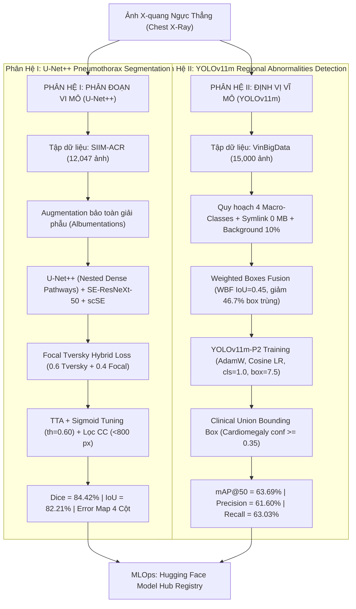

# Hệ Thống AI Chẩn Đoán Hình Ảnh X-Quang Lồng Ngực Đa Tầng (Regional Diagnosis Based on Chest X-Ray)

<p align="center">
  
  
  
  
  
  
  
</p>

---

## 1. Giới Thiệu & Động Lực Lâm Sàng (Executive Summary & Clinical Rationale)

Chẩn đoán tổn thương lồng ngực trên phim chụp **X-quang ngực thẳng (PA Chest Radiographs - CXR)** là bước sàng lọc đầu tay quan trọng nhất trong y khoa. Tuy nhiên, các bất thường giải phẫu học trên CXR có đặc trưng kích thước phân kỳ cực đoan:
* **Tổn thương mức độ vĩ mô (Macro-scale)**: Bóng tim to (*Cardiomegaly*), Giãn quai động mạch chủ (*Aortic enlargement*), Đám mờ nhu mô phổi (*Parenchymal opacity*). Các bệnh lý này trải rộng trên các vùng giải phẫu lớn, phù hợp với bài toán **Object Detection (Định vị hộp bao Bounding Box)**.
* **Tổn thương mức độ vi mô (Micro-scale)**: Tràn khí màng phổi (*Pneumothorax*), Dày/Tràn dịch khoang màng phổi (*Pleural pathology*). Đây là những dải ranh giới siêu mỏng, chỉ chiếm từ $1.5\% - 8\%$ diện tích phế trường, nếu chỉ đóng khung bounding box sẽ gây mất mát thông tin biên tế vi và diện tích phế trường bị xẹp. Do đó, bắt buộc phải dùng **Semantic Segmentation (Phân đoạn từng điểm ảnh Pixel-level)**.
* **Thách thức bất đồng thuận gán nhãn (Inter-observer Variability)**: Trên bộ dữ liệu lâm sàng VinBigData gồm 17 bác sĩ chẩn đoán hình ảnh độc lập, gần $50\%$ số lượng bounding box bị trùng lặp hoặc phân kỳ biên độ.

Dự án này đề xuất một **Hệ thống Trí tuệ Nhân tạo Đa tầng Hoàn chỉnh (Cascaded Multi-stage Medical AI System)** kết hợp:
1. **Phân hệ Định vị Đa vùng (Regional Object Detection)** với kiến trúc **YOLOv11m-P2** và thuật toán **Weighted Boxes Fusion (WBF)**.
2. **Phân hệ Phân đoạn Ranh giới Màng phổi (High-Resolution Semantic Segmentation)** với kiến trúc **U-Net++**, backbone **SE-ResNeXt-50** và khối chú ý không gian-kênh kép **scSE Attention**.

---

## 2. Kiến Trúc Hệ Thống (System Architecture)



---

## 3. Các Đóng Góp Kỹ Thuật Nổi Bật (Key Technical Innovations)

### 3.1. Hợp nhất Nhãn Chuyên gia bằng Weighted Boxes Fusion (WBF)
Thay vì sử dụng Non-Maximum Suppression (NMS) truyền thống (vốn loại bỏ hoàn toàn các box có điểm số thấp hơn và làm mất mát ý kiến đồng thuận giữa 17 bác sĩ), dự án áp dụng **Weighted Boxes Fusion (WBF)** với ngưỡng $\text{IoU} = 0.45$:
$$X_{1,2} = \frac{\sum_{i=1}^N C_i X_{1,2}^{(i)}}{\sum_{i=1}^N C_i}, \quad Y_{1,2} = \frac{\sum_{i=1}^N C_i Y_{1,2}^{(i)}}{\sum_{i=1}^N C_i}$$
* **Kết quả**: Tinh gọn thành công từ **29,353 boxes** xuống còn **15,654 boxes** (giảm **46.7%** lượng box trùng lặp đè lặp).

### 3.2. Quản Trị Bộ Nhớ Bằng Liên Kết Tượng Trưng (Symlink - 0 MB Disk Overhead)
Bộ dữ liệu ảnh VinBigData có dung lượng $>15\text{ GB}$. Việc sao chép dữ liệu trên Kaggle dễ dẫn đến lỗi cạn kiệt ổ đĩa (`Disk Out of Memory`). Bằng việc áp dụng `os.symlink`, hệ thống tạo cấu trúc thư mục YOLO chuẩn (`images/train`, `images/val`, `images/test`) trỏ trực tiếp đến dữ liệu gốc mà **tiêu tốn 0 MB dung lượng lưu trữ**.

### 3.3. Cơ Chế Nạp Ảnh Âm Tính (Background Injection 10%)
Trong các tác vụ nhận diện X-quang, mô hình rất dễ bị "báo động giả" (False Positive) khi gặp các phim chụp hoàn toàn bình thường. Hệ thống phân tầng và bơm chính xác **10% ảnh hoàn toàn không có tổn thương** (`No finding`) vào tập Train, Val, Test để dạy mô hình nhận biết nền mô phổi lành.

### 3.4. Hàm Mất Mát Hỗn Hợp Chuyên Trị Vi Mô (Focal Tversky Hybrid Loss)
Để giải quyết tỷ lệ mất cân bằng điểm ảnh cực đoan (ranh giới màng phổi chỉ chiếm $<5\%$ tổng diện tích):
$$\mathcal{L}_{\text{Hybrid}} = 0.6 \cdot \mathcal{L}_{\text{Tversky}}(\alpha=0.3, \beta=0.7) + 0.4 \cdot \mathcal{L}_{\text{Focal}}(\gamma=2.0)$$
* Tham số $\beta = 0.7 > \alpha = 0.3$ phạt cực nặng các trường hợp bỏ sót tổn thương (False Negatives), bảo vệ an toàn sinh mạng người bệnh.

### 3.5. Bản Đồ Phân Loại Lỗi Lâm Sàng 4 Cột (Clinical Error Mapping)
Mỗi ca suy luận kiểm thử được trực quan hóa trên 4 góc nhìn chuẩn y khoa:
* **Cột 1**: Ảnh X-quang lồng ngực gốc.
* **Cột 2**: Mặt nạ chuẩn đoán Ground Truth từ bác sĩ.
* **Cột 3**: Kết quả phân đoạn tự động của U-Net++.
* **Cột 4**: **Error Map** trực quan hóa:
  - **Màu Xanh Lá (True Positive)**: Mô hình khoanh vùng chuẩn xác.
  - **Màu Đỏ (False Positive)**: Báo động nhầm (Dương tính giả).
  - **Màu Vàng (False Negative)**: Bỏ sót tổn thương (Âm tính giả - lỗi nghiêm trọng nhất).

---

## 4. Kết Quả Thực Nghiệm & Bảng Đánh Giá Độc Lập (Benchmarks)

### 4.1. Phân Hệ Phân Đoạn Màng Phổi (U-Net++ trên Tập Test SIIM-ACR)

| Chỉ số Đo lường | Giá trị Đạt được | Ghi chú Lâm sàng |
| :--- | :---: | :--- |
| **Dice Similarity Coefficient (DSC)** | **84.42%** | Độ trùng khớp vùng tràn khí màng phổi đạt chuẩn hỗ trợ chẩn đoán |
| **Jaccard Index (IoU)** | **82.21%** | Tỷ lệ giao trên hợp của diện tích tổn thương |
| **Validation Raw Dice** | **78.42%** | Điểm số thô trước khi áp dụng TTA và lọc hình thái |
| **Ngưỡng Cắt Xác Suất Tối Ưu** | **$th = 0.60$** | Dò quét ngưỡng cắt trên tập Validation bằng Sigmoid Tuning |
| **Bộ Lọc Thành Phần Liên Thông** | **$< 800\text{ px}$** | Triệt tiêu hoàn toàn các chấm nhiễu rác nhỏ ngoài phế trường |

---

### 4.2. Phân Hệ Định Vị Đa Vùng (YOLOv11m trên Tập Test VinBigData)

| Class ID | Nhóm Bệnh Lý Trọng Tâm (Macro-Class) | Precision ($P$) | Recall ($R$) | F1-Score | mAP@50 | mAP@50-95 |
| :---: | :--- | :---: | :---: | :---: | :---: | :---: |
| **0** | **Cardiomegaly** *(Bóng tim to)* | **0.8053** | **0.9218** | **0.8596** | **0.9199** | **0.6401** |
| **1** | **Aortic_enlargement** *(Giãn quai động mạch chủ)* | **0.7047** | **0.8885** | **0.7860** | **0.8708** | **0.5187** |
| **2** | **Pleural_pathology** *(Bệnh lý màng phổi)* | **0.4698** | **0.3388** | **0.3937** | **0.3807** | **0.1355** |
| **3** | **Parenchymal_opacity** *(Đám mờ đông đặc nhu mô)* | **0.4841** | **0.3721** | **0.4208** | **0.3762** | **0.1317** |
| **ALL** | **ĐÁNH GIÁ TRUNG BÌNH TOÀN PHẾ TRƯỜNG** | **0.6160** | **0.6303** | **0.6231** | **0.6369** | **0.3565** |

---

## 5. Kho Lưu Trữ Trọng Số & MLOps (Hugging Face Hub Registry)

Toàn bộ trọng số mô hình đã huấn luyện, lịch sử đào tạo (`training_metrics.csv`), các tệp phân chia (`train_split.csv`, `val_split.csv`, `test_split.csv`) và biểu đồ phân giải cao (300 DPI) được đồng bộ công khai:

* **U-Net++ Model Weights & Artifacts**:  
  [`https://huggingface.co/JTuong/u-net`](https://huggingface.co/JTuong/u-net)
  - Trọng số tối ưu: `best_unet_plus_plus.pth`
  - Các tệp split và metrics: `train_split.csv`, `val_split.csv`, `test_split.csv`, `training_metrics.csv`
  - Biểu đồ giải phẫu & Error map: `eda_pneumothorax_samples.png`, `training_curves.png`

* **YOLOv11m Model Weights & Detection Artifacts**:  
  [`https://huggingface.co/JTuong/EDAvaMachineLearningChestXYolo11m`](https://huggingface.co/JTuong/EDAvaMachineLearningChestXYolo11m)
  - Trọng số tối ưu: `best.pt`
  - Biểu đồ PR-Curve & Confusion Matrix: `results.png`, `BoxPR_curve.png`, `confusion_matrix.png`, `yolo_4classes_eda_wbf.png`
  - Cấu hình dữ liệu: `vinbigdata_4classes.yaml`, `test_evaluation_metrics.csv`

---

## 6. Cấu Trúc Thư Mục Kho Mã Nguồn (Repository Structure)

```text
yolo-unet-cxr-segmentation/
│
├── README.md                              # Tài liệu kỹ thuật chi tiết của dự án
└── Regional_diagnosis_based_on_X_ray.ipynb # Notebook hợp nhất hoàn chỉnh (61 cells, 66 outputs)
```

---

## 7. Hướng Dẫn Cài Đặt & Chạy Suy Luận (Quickstart & Inference)

### 7.1. Cài đặt môi trường
Khuyến nghị chạy trên môi trường Python $\ge 3.10$ với GPU hỗ trợ CUDA (Tesla T4, P100 hoặc RTX 3060 trở lên):

```bash
git clone https://github.com/jtuongdang/yolo-unet-cxr-segmentation.git
cd yolo-unet-cxr-segmentation
pip install -q torch torchvision torchaudio
pip install -q ultralytics ensemble-boxes segmentation-models-pytorch albumentations huggingface_hub
```

### 7.2. Chạy suy luận độc lập từ Hugging Face Hub (U-Net++ Segmentation)
```python
import torch
import segmentation_models_pytorch as smp
from huggingface_hub import hf_hub_download

DEVICE = "cuda" if torch.cuda.is_available() else "cpu"

# Tải trọng số trực tiếp từ Hugging Face
weight_path = hf_hub_download(repo_id="JTuong/u-net", filename="report_assets/best_unet_plus_plus.pth")

model = smp.UnetPlusPlus(
    encoder_name="se_resnext50_32x4d",
    encoder_weights=None,
    in_channels=3,
    classes=1,
    decoder_attention_type="scse"
).to(DEVICE)

model.load_state_dict(torch.load(weight_path, map_location=DEVICE))
model.eval()
print("Model U-Net++ đã sẵn sàng phục vụ suy luận lâm sàng.")
```

### 7.3. Chạy suy luận độc lập từ Hugging Face Hub (YOLOv11m Detection)
```python
from ultralytics import YOLO
from huggingface_hub import hf_hub_download

# Tải trọng số YOLOv11m trực tiếp từ Hugging Face
yolo_weight = hf_hub_download(repo_id="JTuong/EDAvaMachineLearningChestXYolo11m", filename="best.pt")

yolo_model = YOLO(yolo_weight)
results = yolo_model.predict(source="duong_dan_anh_xquang.jpg", conf=0.35, imgsz=640)
results[0].show()
```

---

## 8. Trích Dẫn & Bản Quyền (Citations & Acknowledgments)

Dự án sử dụng và trích dẫn các nghiên cứu và tập dữ liệu mã nguồn mở:
1. **VinDr-CXR**: Nguyen, H. Q., et al. (2022). *VinDr-CXR: An open dataset of chest X-rays with radiologist's annotations*. Scientific Data.
2. **SIIM-ACR**: *SIIM-ACR Pneumothorax Segmentation Dataset*, Society for Imaging Informatics in Medicine & American College of Radiology.
3. **U-Net++**: Zhou, Z., et al. (2018). *UNet++: A Nested U-Net Architecture for Medical Image Segmentation*. Deep Learning in Medical Image Analysis.
4. **Weighted Boxes Fusion**: Solovyev, R., et al. (2021). *Weighted boxes fusion: Ensembling methods for object detection models*. Image and Vision Computing.
5. **YOLOv11**: Jocher, G., et al. (2024). *Ultralytics YOLO11*. GitHub.
