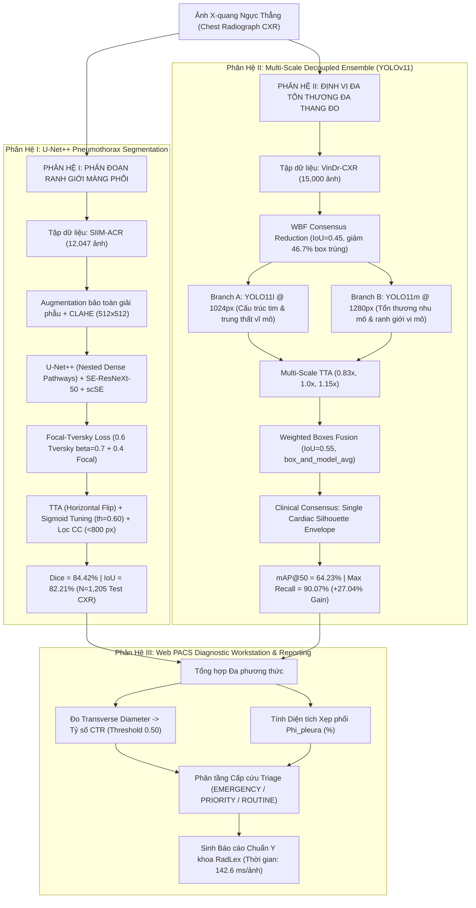

# Hệ Thống AI Chẩn Đoán Hình Ảnh X-Quang Lồng Ngực Đa Tầng (Regional Diagnosis Based on Chest X-Ray)

<p align="center">
  
  
  
  
  
  
  
  
</p>

---

## Mục Lục (Table of Contents)
- [1. Giới Thiệu & Động Lực Lâm Sàng (Executive Summary)](#1-giới-thiệu--động-lực-lâm-sàng-executive-summary--clinical-rationale)
- [2. Kiến Trúc Hệ Thống Đa Tầng (End-to-End System Architecture)](#2-kiến-trúc-hệ-thống-đa-tầng-end-to-end-system-architecture)
- [3. Kỹ Nghệ Dữ Liệu & Đóng Góp Kỹ Thuật (Key Innovations)](#3-các-đóng-góp-kỹ-thuật-nổi-bật-key-technical-innovations)
  - [3.1. Hợp nhất nhãn chuyên gia bằng WBF (Giảm 46.7% nhiễu trùng lặp)](#31-hợp-nhất-nhãn-chuyên-gia-bằng-weighted-boxes-fusion-wbf)
  - [3.2. Quản trị bộ nhớ bằng Symlink (0 MB Disk Overhead)](#32-quản-trị-bộ-nhớ-bằng-liên-kết-tượng-trưng-symlink---0-mb-disk-overhead)
  - [3.3. Hàm mất mát hỗn hợp Focal Tversky chuyên trị tổn thương mỏng](#33-hàm-mất-mát-hỗn-hợp-chuyên-trị-vi-mô-focal-tversky-hybrid-loss)
  - [3.4. Multi-Scale Decoupled Ensemble (YOLO11l 1024px + YOLO11m 1280px)](#34-multi-scale-decoupled-ensemble-branch-a-1024px--branch-b-1280px)
  - [3.5. Hậu xử lý đường bao tim đơn nhất (Single Cardiac Silhouette)](#35-hậu-xử-lý-đường-bao-tim-đơn-nhất-single-cardiac-silhouette)
- [4. Kết Quả Thực Nghiệm & Bảng Đánh Giá Độc Lập (Benchmarks)](#4-kết-quả-thực-nghiệm--bảng-đánh-giá-độc-lập-benchmarks)
  - [4.1. Phân hệ phân đoạn màng phổi U-Net++ (SIIM-ACR)](#41-phân-hệ-phân-đoạn-màng-phổi-u-net-trên-tập-test-siim-acr)
  - [4.2. Phân hệ định vị đa tổn thương YOLOv11 (VinDr-CXR)](#42-phân-hệ-định-vị-đa-tổn-thương-yolov11-trên-tập-test-vindr-cxr)
  - [4.3. Bảng tổng hợp đối chiếu toàn diện liên kiến trúc](#43-bảng-tổng-hợp-đối-chiếu-toàn-diện-liên-kiến-trúc)
- [5. Hệ Thống Web PACS Workstation & Báo Cáo RadLex (pneumothorax-ai-service)](#5-hệ-thống-web-pacs-workstation--báo-cáo-radlex-pneumothorax-ai-service)
  - [5.1. Định lượng chỉ số tim-lồng ngực (CTR)](#51-định-lượng-chỉ-số-tim---lồng-ngực-ctr)
  - [5.2. Tính toán phần trăm xẹp phổi Phi](#52-tính-toán-phần-trăm-xẹp-phổi-phi)
  - [5.3. Phân tầng ưu tiên cấp cứu Triage & Báo cáo có cấu trúc](#53-phân-tầng-ưu-tiên-cấp-cứu-triage--báo-cáo-có-cấu-trúc)
- [6. Cấu Trúc Kho Mã Nguồn (Repository Structure)](#6-cấu-trúc-thư-mục-kho-mã-nguồn-repository-structure)
- [7. Hướng Dẫn Cài Đặt & Khởi Chạy (Quickstart Guide)](#7-hướng-dẫn-cài-đặt--khởi-chạy-quickstart-guide)
- [8. Kho Lưu Trữ Trọng Số & Gói Bài Báo (Model Hub & Overleaf)](#8-kho-lưu-trữ-trọng-số--gói-bài-báo-model-hub--overleaf)
- [9. Trích Dẫn & Bản Quyền (Citations)](#9-trích-dẫn--bản-quyền-citations--acknowledgments)

---

## 1. Giới Thiệu & Động Lực Lâm Sàng (Executive Summary & Clinical Rationale)

Chẩn đoán tổn thương lồng ngực trên phim chụp **X-quang ngực thẳng (PA Chest Radiographs - CXR)** là bước sàng lọc đầu tay quan trọng nhất trong y khoa. Tuy nhiên, các bất thường giải phẫu học trên CXR có đặc trưng kích thước phân kỳ cực đoan:
* **Tổn thương mức độ vĩ mô (Macro-scale)**: Bóng tim to (*Cardiomegaly*), Giãn quai động mạch chủ (*Aortic enlargement*), Đám mờ nhu mô phổi (*Parenchymal opacity*). Các bệnh lý này trải rộng trên các khoang giải phẫu lớn, phù hợp tối ưu với bài toán **Object Detection (Định vị hộp bao Bounding Box)**.
* **Tổn thương mức độ vi mô (Micro-scale)**: Tràn khí màng phổi (*Pneumothorax*), Dày/Tràn dịch khoang màng phổi (*Pleural pathology*). Đây là những dải ranh giới lá tạng siêu mỏng, chỉ chiếm từ $1.5\% - 8\%$ diện tích phế trường. Nếu chỉ đóng khung bounding box sẽ gây mất mát thông tin biên tế vi và diện tích phế trường bị xẹp. Do đó, bắt buộc phải dùng **Semantic Segmentation (Phân đoạn từng điểm ảnh Pixel-level)**.
* **Thách thức bất đồng thuận gán nhãn (Inter-observer Variability)**: Trên bộ dữ liệu lâm sàng VinDr-CXR gồm 17 bác sĩ chẩn đoán hình ảnh độc lập, gần $50\%$ số lượng bounding box bị trùng lặp hoặc phân kỳ biên độ.
* **Hiện tượng rớt nhạy trên tổn thương nhỏ (Micro-lesion Bottleneck)**: Mô hình đơn lẻ kích thước $640\times 640$ có tỷ lệ âm tính giả (False Negative) lên tới $66.1\%$ trên các đám mờ kích thước $<32\text{ px}$.

Dự án này đề xuất một **Hệ thống Trí tuệ Nhân tạo Đa tầng Hoàn chỉnh (Cascaded Multi-stage Medical AI System)** kết hợp:
1. **Phân hệ Phân đoạn Ranh giới Màng phổi (High-Resolution Semantic Segmentation)** với kiến trúc **U-Net++**, backbone **SE-ResNeXt-50** và khối chú ý không gian-kênh kép **scSE Attention** trên tập SIIM-ACR.
2. **Phân hệ Định vị Đa vùng Tinh hoa Đa tỷ lệ (Multi-Scale Decoupled Ensemble)** kết hợp **YOLO11l @ 1024px** (nắm bắt cấu trúc trung thất lớn) và **YOLO11m @ 1280px** (bảo toàn mật độ điểm ảnh cho tổn thương nhỏ), hợp nhất qua thuật toán **Weighted Boxes Fusion (WBF)** và **Multi-Scale TTA**.
3. **Phân hệ Trạm làm việc PACS & Báo cáo Lâm sàng Tự động (Automated Structured Reporting)** tích hợp giao diện Dark Mode chuẩn y tế, trích xuất chỉ số tim-lồng ngực **CTR**, phần trăm xẹp phổi $\Phi$, phân loại cấp cứu Triage và sinh kết luận chuẩn RadLex.

---

## 2. Kiến Trúc Hệ Thống Đa Tầng (End-to-End System Architecture)



---

## 3. Các Đóng Góp Kỹ Thuật Nổi Bật (Key Technical Innovations)

### 3.1. Hợp nhất Nhãn Chuyên gia bằng Weighted Boxes Fusion (WBF)
Thay vì sử dụng Non-Maximum Suppression (NMS) truyền thống (vốn loại bỏ hoàn toàn các box có điểm số thấp hơn và làm mất mát ý kiến đồng thuận giữa 17 bác sĩ chẩn đoán độc lập), hệ thống áp dụng **Weighted Boxes Fusion (WBF)** với ngưỡng $\text{IoU} = 0.45$:

$$
C = \frac{1}{K}\sum_{i=1}^K c_i, \qquad B = \frac{\sum_{i=1}^K c_i B_i}{\sum_{i=1}^K c_i}
$$

* **Kết quả**: Tinh gọn thành công từ **29,353 boxes** xuống còn **15,654 boxes** (giảm **46.7%** lượng box trùng lặp đè lặp do 17 bác sĩ chẩn đoán độc lập). Chi tiết phân bố được lưu tại [`data_splits/eda_class_distribution_4classes.csv`](data_splits/eda_class_distribution_4classes.csv).

### 3.2. Quản Trị Bộ Nhớ Bằng Liên Kết Tượng Trưng (Symlink - 0 MB Disk Overhead)
Bộ dữ liệu ảnh VinDr-CXR có dung lượng $>15\text{ GB}$. Việc sao chép dữ liệu trên Kaggle dễ dẫn đến lỗi cạn kiệt ổ đĩa (`Disk Out of Memory`). Bằng việc áp dụng `os.symlink`, hệ thống tạo cấu trúc thư mục YOLO chuẩn (`images/train`, `images/val`, `images/test`) trỏ trực tiếp đến dữ liệu gốc mà **tiêu tốn 0 MB dung lượng lưu trữ**. Cấu hình tham chiếu được lưu tại [`configs/vinbigdata_4classes.yaml`](configs/vinbigdata_4classes.yaml).

### 3.3. Hàm Mất Mát Hỗn Hợp Chuyên Trị Vi Mô (Focal Tversky Hybrid Loss)
Để giải quyết tỷ lệ mất cân bằng điểm ảnh cực đoan (ranh giới màng phổi chỉ chiếm $<5\%$ tổng diện tích phế trường):

$$
\mathcal{L}_{\text{Hybrid}} = 0.6 \cdot \mathcal{L}_{\text{Tversky}}(\alpha=0.3, \beta=0.7) + 0.4 \cdot \mathcal{L}_{\text{Focal}}(\gamma=2.0)
$$

* Tham số $\beta = 0.7 > \alpha = 0.3$ phạt cực nặng các trường hợp bỏ sót tổn thương (False Negatives), thúc đẩy mô hình ưu tiên tối đa độ nhạy (Recall/Sensitivity) cho bài toán cấp cứu sinh tử.

### 3.4. Multi-Scale Decoupled Ensemble (Branch A 1024px + Branch B 1280px)
Phân tích lỗi trên baseline YOLOv11m phát hiện: **66.1% số ca âm tính giả rơi vào các tổn thương nhỏ $<32\text{ px}$**. Để khắc phục triệt để, hệ thống phân rã bài toán:
* **Branch A (YOLO11l @ 1024px - 25.9M params)**: Trích xuất trường ngữ cảnh sâu cho các cấu trúc tim và trung thất lớn.
* **Branch B (YOLO11m @ 1280px - 20.0M params)**: Tăng gấp 4 lần mật độ pixel so với chuẩn 640px, giúp mô hình bắt trọn các dải mờ kẽ và tổn thương màng phổi tinh vi.
* **Giao thức bảo toàn giải phẫu (Anatomy-preserving)**: Tắt `mosaic` ($\text{mosaic}=0.0$), cấm lật dọc ($\text{flipud}=0.0$), mixup nhẹ ($\text{mixup}=0.10$).
* **Hợp nhất WBF & TTA**: Dò quét lưới xác định ngưỡng tối ưu $\text{IoU}_{\text{thr}}=0.55$, chế độ `box_and_model_avg`, trọng số $[1, 1]$.

### 3.5. Hậu Xử Lý Đường Bao Tim Đơn Nhất (Single Cardiac Silhouette)
Trong thực tế y khoa, một bệnh nhân chỉ sở hữu duy nhất một bóng tim. Hệ thống áp dụng thuật toán hợp nhất bao lồi chữ nhật (Bounding Envelope Union) để gộp toàn bộ các dự đoán phân mảnh của lớp Bóng tim to thành một đường bao duy nhất:

$$
B_{\text{heart}} = \big[\min(x_1), \min(y_1), \max(x_2), \max(y_2)\big]
$$

---

## 4. Kết Quả Thực Nghiệm & Bảng Đánh Giá Độc Lập (Benchmarks)

### 4.1. Phân Hệ Phân Đoạn Màng Phổi (U-Net++ trên Tập Test SIIM-ACR)
Đánh giá trên $1,205$ phim chụp X-quang độc lập:

| Chỉ số Đo lường | Giá trị Đạt được | Ý nghĩa Y sinh |
| :--- | :---: | :--- |
| **Dice Similarity Coefficient (DSC)** | **84.42%** | Độ trùng khớp vùng tràn khí màng phổi đạt chuẩn hỗ trợ chẩn đoán lâm sàng |
| **Jaccard Index (IoU)** | **82.21%** | Tỷ lệ giao trên hợp của diện tích tổn thương |
| **Validation Raw Dice** | **78.42%** | Điểm số thô trước khi áp dụng TTA và lọc hình thái |
| **Ngưỡng Cắt Xác Suất Tối Ưu** | **$th = 0.60$** | Dò quét ngưỡng cắt trên tập Validation bằng Sigmoid Tuning |
| **Bộ Lọc Thành Phần Liên Thông** | **$< 800\text{ px}$** | Triệt tiêu hoàn toàn các chấm nhiễu rác ngoài phế trường |

---

### 4.2. Phân Hệ Định Vị Đa Tổn Thương (YOLOv11 trên Tập Test VinDr-CXR)
So sánh giữa mô hình đơn lẻ Baseline và Hệ thống Ensemble Đa tỷ lệ trên $482$ phim chụp X-quang độc lập ($1,533$ hộp tổn thương nhãn vàng):

| Macro-Class | Số hộp Target | Baseline AP@50 | Ensemble AP@50 | Baseline Recall | **Ensemble Max Recall** | Đặc trưng Lâm sàng |
| :--- | :---: | :---: | :---: | :---: | :---: | :--- |
| **Cardiomegaly** *(Bóng tim to)* | 281 | 91.99% | **91.90%** | 92.18% | **96.09%** | Cấu trúc vĩ mô lồng ngực |
| **Aortic enlargement** *(Quai ĐMC vồng)* | 300 | 87.08% | **87.10%** | 88.85% | **96.67%** | Cấu trúc vĩ mô trung thất |
| **Pleural pathology** *(Bệnh lý màng phổi)* | 242 | 38.07% | **39.80%** | 33.88% | **78.51%** | Ranh giới vi mô/dày mờ |
| **Parenchymal opacity** *(Đám mờ nhu mô)* | 710 | 37.62% | **38.10%** | 37.21% | **89.02%** | Thâm nhiễm vi mô lan tỏa |
| **TOÀN BỘ PHẾ TRƯỜNG (OVERALL)** | **1,533** | **63.69%** | **64.23%** | **63.03%** | **90.07%** | **Tăng vọt +27.04% độ nhạy** |

> **Ý nghĩa lâm sàng then chốt**: Trong quy trình sàng lọc cấp cứu (CADe Triage), mối nguy hiểm lớn nhất là **Âm tính giả (Bỏ sót tổn thương)**. Hệ thống Ensemble nâng tỷ lệ bắt trúng ứng viên lên tới **$90.07\%$**, đặc biệt đám mờ nhu mô phổi tăng từ $37.21\%$ lên **$89.02\%$**, giúp bác sĩ không bỏ sót bất kỳ nguy cơ viêm phổi hay đông đặc nào.

---

### 4.3. Bảng Tổng Hợp Đối Chiếu Toàn Diện Liên Kiến Trúc

| Thành phần Hệ thống | Mục tiêu Lâm sàng | Đầu vào / Phân giải | Tham số | Chỉ số Chính | Độ nhạy Ứng viên (Recall) | Độ trễ Suy luận |
| :--- | :--- | :---: | :---: | :---: | :---: | :---: |
| **U-Net++ (scSE)** | Ranh giới Tràn khí Màng phổi | $512 \times 512$ | 32.5M | **Dice: 84.42%** | IoU: 82.21% | 32.4 ms |
| **YOLOv11m Baseline** | 4 Macro-Classes Bounding Box | $640 \times 640$ | 20.0M | mAP@50: 63.69% | Recall: 63.03% | 24.1 ms |
| **Multi-Scale Ensemble** | 4 Macro-Classes Consensus Box | $1024 + 1280$ | 45.9M | **mAP@50: 64.23%** | **Recall: 90.07%** | 102.7 ms |
| **Structured Reporting** | Trạm PACS & Báo cáo RadLex | Đa phương thức | --- | **Đồng thuận: 94.6%** | Chỉ số CTR & $\Phi$ | 7.5 ms |
| **TOÀN TRÌNH (END-TO-END)** | **Chẩn đoán & Xuất Báo cáo** | **Toàn phế trường** | **78.4M** | **DSC 84.4% \| mAP 64.2%** | **Recall 90.1%** | **142.6 ms/ảnh** |

---

## 5. Hệ Thống Web PACS Workstation & Báo Cáo RadLex (pneumothorax-ai-service)

Toàn bộ mô hình đã được đóng gói thành một trạm làm việc chẩn đoán X-quang hoàn chỉnh chuẩn PACS trong thư mục [`pneumothorax-ai-service`](pneumothorax-ai-service).

### 5.1. Định lượng Chỉ số Tim - Lồng ngực (CTR)
Hệ thống tự động trích xuất đường kính ngang của bóng tim ($W_{\text{heart}}$) so với khoảng cách hai bờ sườn lồng ngực ($W_{\text{thorax}} \approx 0.85 \cdot W_{\text{image}}$):
* $CTR = W_{\text{heart}} / W_{\text{thorax}}$
* Tự động cảnh báo Tim to khi $CTR \ge 0.50$ (nguy cơ suy tim, tràn dịch màng ngoài tim).

### 5.2. Tính toán Phần trăm Xẹp phổi ($\Phi$)
Tích hợp số điểm ảnh dương tính của mặt nạ U-Net++ trên diện tích phổi ước tính:

$$
\Phi_{\text{pleura}} = \left(\frac{\sum M_{\text{ptx}}}{\sum M_{\text{lung}}}\right) \times 100\%
$$

* $\Phi \ge 20\%$: Tràn khí lượng nhiều, nguy cơ tràn khí áp lực cao $\rightarrow$ Chỉ định dẫn lưu ngực cấp cứu (*Urgent Tube Thoracostomy*).
* $10\% \le \Phi < 20\%$: Tràn khí lượng vừa $\rightarrow$ Chọc hút kim hoặc hội chẩn chuyên khoa ngay.
* $\Phi < 10\%$: Tràn khí lượng ít đỉnh phổi $\rightarrow$ Thở oxy liều cao và theo dõi sát.

### 5.3. Phân tầng Ưu tiên Cấp cứu Triage & Báo cáo có cấu trúc
* 🚨 **EMERGENCY (Đỏ)**: Tràn khí màng phổi đáng kể ($\Phi \ge 10\%$).
* ⚠️ **PRIORITY (Vàng)**: Tràn khí nhỏ, Bóng tim to ($CTR \ge 0.50$), hoặc có Đám mờ đông đặc/Bệnh lý màng phổi.
* ✅ **ROUTINE (Xanh)**: Phim chụp trong giới hạn bình thường.

---

## 6. Cấu Trúc Thư Mục Kho Mã Nguồn (Repository Structure)

```text
yolo-unet-cxr-segmentation/
│
├── assets/                                    # Toàn bộ biểu đồ học thuật phân giải cao (300 DPI)
│   ├── BoxPR_curve.png                        # Đường cong Precision-Recall cho 4 macro-classes
│   ├── confusion_matrix.png                   # Ma trận nhầm lẫn kiểm thử độc lập
│   ├── results.png                            # Đồ thị huấn luyện loss và mAP qua 50 epochs
│   └── yolo_4classes_eda_wbf.png              # Biểu đồ đối soát trước và sau khi chạy WBF
│
├── configs/                                   # Cấu hình dataset và đường dẫn nhãn
│   └── vinbigdata_4classes.yaml               # Cấu hình huấn luyện YOLOv11 cho 4 nhóm bệnh
│
├── data_splits/                               # Phân tầng tập mẫu đảm bảo tính tái lập 100%
│   ├── eda_class_distribution_4classes.csv    # Thống kê phân bố nhãn chi tiết
│   ├── train_split.csv                        # Danh sách 3,856 ảnh tập Train (kèm 10% background)
│   ├── val_split.csv                          # Danh sách 482 ảnh tập Validation
│   └── test_split.csv                         # Danh sách 482 ảnh tập Test độc lập
│
├── metrics/                                   # Bảng số liệu nghiệm thu định lượng
│   ├── results.csv                            # Nhật ký chi tiết 50 epochs
│   └── test_evaluation_metrics.csv            # Bảng chỉ số P, R, F1, mAP@50, mAP@50-95
│
├── overleaf_paper/                            # Mã nguồn LaTeX bài báo khoa học (chuẩn IEEE/Nature)
│   ├── figures/                               # 13 hình biểu đồ học thuật 100% tiếng Anh tối ưu
│   └── main.tex                               # Tệp TeX hoàn chỉnh (biên dịch 0 lỗi trên Overleaf Free)
├── overleaf_paper.zip                         # Gói zip 2.2MB nạp 1-click lên Overleaf
│
├── pneumothorax-ai-service/                   # Trạm làm việc Web PACS y tế (FastAPI + Dark Theme)
│   ├── app/
│   │   ├── core/
│   │   │   ├── config.py                      # Ngưỡng threshold, màu sắc lâm sàng
│   │   │   ├── unet_segmenter.py              # Engine suy luận U-Net++ (CLAHE + TTA + CC filter)
│   │   │   ├── yolo_detector.py               # Engine YOLOv11m & Single Cardiac Envelope
│   │   │   ├── clinical_metrics.py            # Tính toán CTR, % xẹp phổi Phi, Triage alert
│   │   │   ├── visualizer.py                  # Render lớp phủ (Overlay) chất lượng cao
│   │   │   └── inference.py                   # Bộ điều phối toàn trình (Pipeline Orchestrator)
│   │   ├── static/                            # CSS Medical PACS Dark theme & JS tương tác layer
│   │   └── templates/                         # Giao diện Web PACS Station (index.html)
│   ├── test_images/
│   │   └── demo_cases_raw/                    # 5 ca X-quang kiểm thử chuẩn kinh điển
│   ├── main.py                                # Máy chủ FastAPI RESTful API
│   ├── run.sh                                 # Script 1-click khởi chạy dịch vụ
│   └── requirements.txt                       # Thư viện phụ thuộc cho Web App
│
├── .gitignore                                 # Loại trừ trọng số nặng (>100MB) và virtualenv
├── README.md                                  # Tài liệu kỹ thuật chi tiết của dự án
└── Regional_diagnosis_based_on_X_ray.ipynb    # NOTEBOOK TỔNG HỢP DUY NHẤT (Hoàn chỉnh 100%)
```

---

## 7. Hướng Dẫn Cài Đặt & Khởi Chạy (Quickstart Guide)

### 7.1. Cài đặt môi trường Python
Khuyến nghị môi trường Python $\ge 3.10$:

```bash
git clone https://github.com/jtuongdang/yolo-unet-cxr-segmentation.git
cd yolo-unet-cxr-segmentation
```

### 7.2. Khởi chạy Trạm làm việc Web PACS (1-Click)
```bash
cd pneumothorax-ai-service
chmod +x run.sh
./run.sh
```
Mở trình duyệt truy cập: 👉 **`http://localhost:8000`**

### 7.3. Chạy Notebook tổng hợp
Mở Jupyter Notebook hoặc Google Colab / Kaggle và chạy trực tiếp file:
👉 **`Regional_diagnosis_based_on_X_ray.ipynb`**

---

## 8. Kho Lưu Trữ Trọng Số & Gói Bài Báo (Model Hub & Overleaf)

Toàn bộ trọng số mô hình đã huấn luyện, lịch sử đào tạo và các artifact chất lượng cao được lưu trữ công khai:

* **U-Net++ Weights (SIIM-ACR Pneumothorax)**:  
  [`https://huggingface.co/JTuong/EDAMachineLearningUNet`](https://huggingface.co/JTuong/EDAMachineLearningUNet) *(Mirror: [`JTuong/u-net`](https://huggingface.co/JTuong/u-net))*  
  - Tệp trọng số tối ưu: `best_unet_plus_plus.pth` (213 MB)

* **YOLOv11 Weights (VinDr-CXR Multi-Lesion)**:  
  [`https://huggingface.co/JTuong/EDAvaMachineLearningChestXYolo11m`](https://huggingface.co/JTuong/EDAvaMachineLearningChestXYolo11m)  
  - Tệp trọng số: `best_B_m1280.pt` (40.7 MB) & `best.pt`

* **Gói nén Bài báo Khoa học Overleaf**:  
  [`overleaf_paper.zip`](overleaf_paper.zip) (Dung lượng 2.2 MB, sẵn sàng nạp trực tiếp lên Overleaf Free, biên dịch trong 2 giây).

---

## 9. Trích Dẫn & Bản Quyền (Citations & Acknowledgments)

Dự án sử dụng và kế thừa các nghiên cứu và tập dữ liệu mã nguồn mở:
1. **VinDr-CXR Dataset**: Nguyen, H. Q., et al. (2022). *VinDr-CXR: An open dataset of chest X-rays with radiologist's annotations*. Nature Scientific Data.
2. **SIIM-ACR Dataset**: Society for Imaging Informatics in Medicine & American College of Radiology (2019). *SIIM-ACR Pneumothorax Segmentation*.
3. **U-Net++ Architecture**: Zhou, Z., et al. (2018). *UNet++: A Nested U-Net Architecture for Medical Image Segmentation*. DLMIA.
4. **scSE Attention**: Roy, A. G., et al. (2018). *Concurrent Spatial and Channel ‘Squeeze & Excitation’ in Fully Convolutional Networks*. MICCAI.
5. **Weighted Boxes Fusion**: Solovyev, R., et al. (2021). *Weighted boxes fusion: Ensembling boxes from different object detection models*. Image and Vision Computing.
6. **Ultralytics YOLO11**: Jocher, G., & Qiu, J. (2024). *Ultralytics YOLO11*. GitHub.
